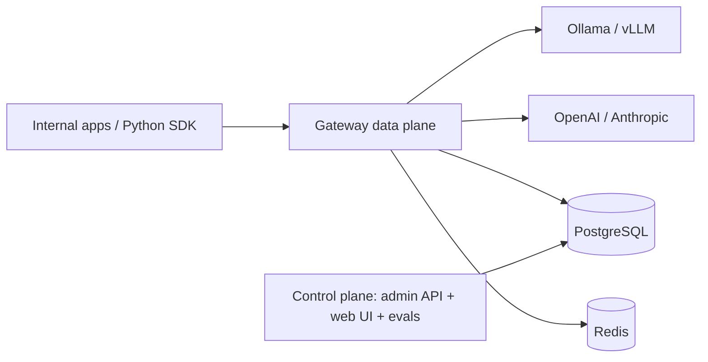

# Internal LLM Gateway

A company-owned, OpenAI-compatible front door for all internal LLM traffic. It starts as a provider router across local and commercial providers and hardens into a production platform: auth and RBAC, rate limiting, retry and circuit breaking, usage and cost tracking, secrets management, observability, request validation, guardrails, evals, and a monitoring/analytics web app.

**Status:** Planning. No implementation code yet. The PRD, architecture, and delivery breakdown are ready for review.

---

## Why This Exists

Today each team integrates providers directly, which creates uncontrolled spend, fragile integrations, scattered API keys, no audit trail, and no shared learning. The gateway centralizes LLM traffic behind one governed endpoint so the company can control access, cost, reliability, safety, and visibility without slowing teams down.

**The core bet:** centralizing LLM traffic behind one governed gateway is cheaper and safer than every team integrating providers independently — but only if adoption is easier than bypassing it.

---

## Documents

| Document | Purpose |
| --- | --- |
| [PRD.md](PRD.md) | Product requirements, personas, scope, KPIs, open questions, and delivery phases. |
| [ARCHITECTURE.md](ARCHITECTURE.md) | Human-facing architecture: components, request lifecycle, routing, data, security, deployment, trade-offs. |
| [ARCHITECTURE-SPINE.md](ARCHITECTURE-SPINE.md) | Terse, machine-checkable invariants (AD-1 to AD-17), stack pins, and capability map. |
| [EPICS.md](EPICS.md) | Agile decomposition: 9 epics, 55 stories with acceptance criteria and requirement traceability. |
| [.memlog.md](.memlog.md) | Architecture decision log (append-only provenance). |

Recommended reading order: PRD → ARCHITECTURE → ARCHITECTURE-SPINE → EPICS.

---

## Delivery Phases

| Phase | Focus | Exit signal |
| --- | --- | --- |
| **0 — Router** | OpenAI-compatible endpoint, streaming, failover before first token, validation, secrets, observability baseline, SDK sync/stream. | One pilot team streams through the gateway. |
| **1 — Production Pilot** | Identity and RBAC, retry and health, config snapshots, alerting, health dashboard, SDK hardening. | 3–5 teams onboarded; RBAC enforced; on-call runbook. |
| **2 — Cost & Control** | Rate limits and quotas, usage/cost attribution, circuit automation, capability-aware routing, cost dashboard, admin console. | Spend attributable; quotas enforced. |
| **3 — Safety & Quality** | Input guardrails, budgets/alerts, eval harness and gates. | Guardrails configurable; eval gate for alias/model changes. |

---

## Architecture at a Glance

- **Rust data plane** (Axum/Tokio) with a fixed request pipeline: validate → authn → authz → rate/quota → input guardrail → route → resilience → provider → output guardrail → meter → audit.
- **Hexagonal ports and adapters** over a DDD core. The domain owns routing and cost rules and has no I/O.
- **Control plane** separate from the data plane: admin API, monitoring/analytics UI, eval runner.
- **State:** Postgres is the system of record; Redis holds ephemeral counters, circuit, and health state.
- **Streaming rule:** failover only before the first token; after that the stream is committed.
- **Python SDK** is a thin client over `httpx` plus `pydantic`; failover lives in the gateway, not the SDK.



Full detail lives in [ARCHITECTURE.md](ARCHITECTURE.md) and [ARCHITECTURE-SPINE.md](ARCHITECTURE-SPINE.md).

---

## Planned Repository Layout

```text
llmgw/
  Cargo.toml                 # workspace
  crates/
    domain/                  # routing policy, capabilities, error taxonomy; no I/O
    application/             # pipeline stages, use cases, port traits
    gateway/                 # Axum, adapters, persistence, identity, secrets, telemetry
  control-plane/             # admin API + monitoring/analytics web app (separate deployment)
  sdk/python/                # LLM router client (httpx + pydantic)
  migrations/                # Postgres schema
  deploy/                    # manifests and environment overlays
```

This is the current plan, not yet built. See the architecture documents for the invariants that govern it.

---

## Getting Started

There is nothing to run yet. To contribute or review:

1. Read [PRD.md](PRD.md) for scope and priorities.
2. Read [ARCHITECTURE-SPINE.md](ARCHITECTURE-SPINE.md) for the invariants that must hold.
3. Pick a Phase 0 story from [EPICS.md](EPICS.md); E1 stories have no upstream dependencies.

### Resolve Before Phase 1

The PRD carries open questions that do not block Phase 0 but must be answered before the phase that depends on them — identity provider, secret manager, deployment environment, retry budget, alias authority, quota enforcement mode, guardrail placement, eval ownership, retention, and non-chat modalities. See [PRD.md §10](PRD.md#10-assumptions--open-questions).

---

## Non-Goals (v1)

- Public multi-tenant SaaS operation.
- Full billing and invoicing.
- Non-chat modalities.
- Hosting model inference.
- Becoming a prompt or agent framework.

---

## Ownership

| Area | Owner |
| --- | --- |
| Product and scope | John (PM) |
| Architecture and invariants | Winston (System Architect) |
| Implementation | Engineering / Platform Infrastructure |
| Security review | Security / Compliance |

---

## License

Internal use only. See repository `LICENSE` for terms.
