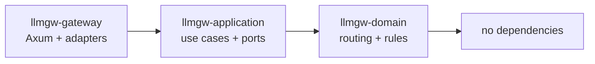
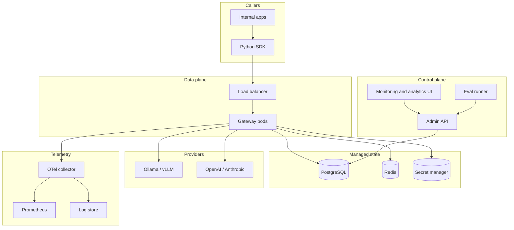
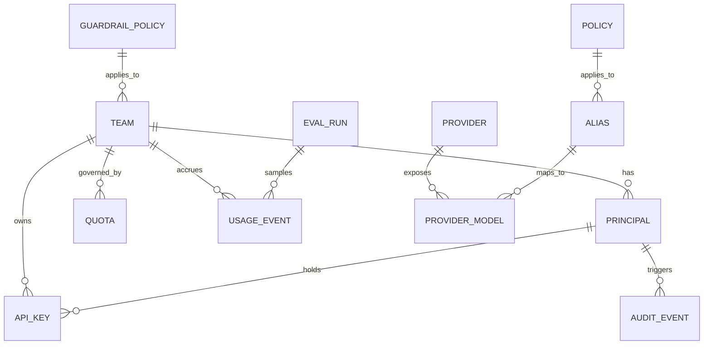

# Architecture Spine — Internal LLM Gateway

## Design Paradigm

Hexagonal architecture (ports and adapters) wrapped around a Domain-Driven Design core. The domain owns routing policy, target selection, capability matching, and cost rules and has no runtime dependencies. The application layer owns use cases and defines the ports; infrastructure implements them (Axum, provider adapters, Postgres, Redis, secret store, telemetry). This keeps provider and transport concerns out of the rules that decide where traffic goes.



Namespace mapping:

- `llmgw-domain` — entities, value objects, routing policy, capability matching, error taxonomy.
- `llmgw-application` — request pipeline, use cases, inbound/outbound port traits.
- `llmgw-gateway` — Axum server, provider adapters, persistence, identity, secrets, telemetry, admin API.

## Invariants & Rules

### AD-1 — Hexagonal dependency direction

- **Binds:** all crates, all capabilities
- **Prevents:** routing rules, cost logic, or provider conditionals leaking into HTTP handlers or provider adapters, which makes behavior untestable and inconsistent across providers.
- **Rule:** dependencies point one way: gateway to application to domain. The domain crate depends on no other workspace crate and no I/O library. Application defines ports as traits; gateway supplies implementations. Any exception is a review blocker.

### AD-2 — Fixed ordered request pipeline

- **Binds:** REQ-ENG, REQ-VAL, REQ-AUTH, REQ-RATE, REQ-RES, REQ-GRD, REQ-COST
- **Prevents:** teams adding, reordering, or skipping stages, so a request reaches a provider without auth, validation, quota, or metering.
- **Rule:** every data-plane request traverses one immutable stage sequence: transport, validate, authenticate, authorize, rate limit and quota, input guardrail, route, resilience loop, provider call, output guardrail, meter, audit. Each stage is a trait with a typed result of continue, reject, or terminate. Only the resilience loop may call a provider, and it may call it more than once per AD-3 and AD-15.

### AD-3 — Streaming and failover boundary

- **Binds:** REQ-ENG-02, REQ-ENG-03, REQ-ENG-08, REQ-RES-02
- **Prevents:** two providers emitting tokens into one stream, duplicated output, or a retry after the caller has already seen content, which corrupts responses and bills twice.
- **Rule:** failover and retry are allowed only before the first token is forwarded. After the first token, the stream is committed: no retry, no failover. A mid-stream upstream failure terminates the SSE stream with one gateway error event followed by the done sentinel. The first-token boundary is the single switch both routing and resilience read.

### AD-4 — Provider adapter contract

- **Binds:** REQ-ENG-01, REQ-ENG-04, REQ-ENG-06, REQ-RES
- **Prevents:** each provider integration inventing its own request shape, error handling, or capability assumptions, so fallback silently selects a target that cannot serve the request.
- **Rule:** every adapter implements one port and converts the canonical internal request to the provider wire format and back. Each adapter declares a capability descriptor (tools, JSON mode, vision, context window, streaming) and maps failures into the shared error taxonomy. Provider-specific fields never cross into the OpenAI-compatible surface.

### AD-5 — Routing policy is pure

- **Binds:** REQ-ENG-03, REQ-ENG-04, REQ-ENG-06, REQ-ENG-07, REQ-RES-04
- **Prevents:** routing decisions hidden in adapters, wall-clock calls, network lookups, or random tie-breaks that cannot be unit-tested or reproduced.
- **Rule:** the domain exposes one pure function that takes the request, principal, resolved policy, capability requirements, and a provider-health snapshot, and returns an ordered target list with its reasons. No I/O, no clock, no randomness inside it. The caller supplies time and health. Given the same inputs, the output is identical.

### AD-6 — State ownership

- **Binds:** REQ-ENG-05, REQ-RATE, REQ-RES, REQ-COST, REQ-AUTH-04
- **Prevents:** two components owning the same record, dual writes, and counters that disagree after a pod restart.
- **Rule:** Postgres is the system of record for control-plane configuration, usage events, and audit events. Redis holds only ephemeral, rebuildable state: rate-limit counters, circuit-breaker state, and the provider-health cache. No durable business fact exists only in Redis. Configuration is read as a versioned snapshot cached in process and refreshed on a bounded interval.

### AD-7 — Config versus secrets

- **Binds:** REQ-ENG-05, REQ-SEC
- **Prevents:** provider keys in env files, config maps, database rows, logs, or traces, and secret sprawl across deployments.
- **Rule:** non-secret configuration lives in versioned control-plane records. Secrets live only in the company secret manager and are resolved at runtime through a secrets port, cached with a short TTL. Secrets are never written to persistent storage, never logged, and never returned by any API. Redaction is tested, not assumed.

### AD-8 — Identity, tenancy, and authorization

- **Binds:** REQ-AUTH, REQ-RATE, REQ-COST, REQ-UI
- **Prevents:** unauthenticated or cross-tenant access, shared keys with unlimited scope, and provider credentials reaching callers.
- **Rule:** every data-plane call carries a principal resolved from an OIDC JWT or a gateway-issued scoped API key. Every principal belongs to exactly one team and holds scopes for teams, aliases, models, and operations. Every query and every usage record is scoped by team. Provider keys exist only inside the gateway. Missing principal, missing scope, or team mismatch is rejected before routing.

### AD-9 — Usage and cost are immutable facts

- **Binds:** REQ-COST, REQ-RATE-03, REQ-UI-02
- **Prevents:** retroactive price edits rewriting history, double counting on retries, and reports that cannot be reconciled to requests.
- **Rule:** each provider attempt produces one immutable usage event keyed by request id plus attempt id, recording principal, team, alias, provider, model, token counts, latency, outcome, and a cost snapshot computed from the price table version active at event time. Aggregates are derived from events, never edited in place.

### AD-10 — Telemetry contract

- **Binds:** REQ-OBS, REQ-UI-01, REQ-UI-03
- **Prevents:** each module emitting ad-hoc metric names and attributes, so dashboards and alerts cannot be shared or predicted.
- **Rule:** all spans and metrics follow one published contract: a request id is generated at transport and propagated to callers and upstream calls; spans use the fixed pipeline stage names from AD-2; Prometheus metrics live in the `llmgw_` namespace with a fixed label set. New metrics require a contract change, not a local name.

### AD-11 — Error envelope

- **Binds:** REQ-VAL, REQ-AUTH, REQ-RATE, REQ-RES, REQ-SDK-04
- **Prevents:** raw provider errors, stack traces, or secret-bearing messages reaching clients, and the SDK and web app each parsing a different shape.
- **Rule:** every rejection uses one OpenAI-compatible error envelope with a stable gateway error code, a human message, and a request id. Internal errors map to HTTP status through one table. Provider bodies and internal details are logged server-side and never forwarded.

### AD-12 — Control plane and data plane separation

- **Binds:** REQ-AUTH-05, REQ-UI, REQ-EVAL
- **Prevents:** admin operations and dashboards sitting on the hot request path, and data-plane pods gaining write access to configuration.
- **Rule:** the data plane is read-only against configuration and appends only usage and audit events. The control plane owns writes to teams, keys, quotas, policies, providers, and aliases, and exposes a separate authenticated API for the web app. Data-plane pods hold no admin credentials and never call the web app.

### AD-13 — Deployment envelope

- **Binds:** all, NFR availability and operations
- **Prevents:** environment drift and a target that cannot reach the stated SLO because state is trapped in one pod.
- **Rule:** data-plane pods are stateless and horizontally scaled behind a load balancer on Kubernetes. Postgres and Redis are managed services. Secrets arrive through the secret manager. Telemetry goes to an OpenTelemetry collector feeding Prometheus and the log store. The control plane and web app deploy separately from the data plane. Every environment is provisioned from the same manifests with environment-specific values only.

### AD-14 — Guardrails as provider-agnostic stages

- **Binds:** REQ-GRD
- **Prevents:** guardrail logic welded to one vendor or one model, and blocking behavior that differs per team with no audit trail.
- **Rule:** guardrails are pipeline stages behind one interface returning allow, flag, redact, or block, with an explicit per-policy fail-open or fail-closed mode. Policies are versioned control-plane data. Input guardrails run before routing. Output guardrails for streaming are deferred and must not buffer tokens once the stream is committed.

### AD-15 — Attempt budget and idempotency

- **Binds:** REQ-RES-01, REQ-RES-05, REQ-COST
- **Prevents:** unbounded retries, thundering herds after a provider incident, and silent double billing.
- **Rule:** each request carries an attempt budget (maximum attempts and maximum elapsed time) plus an idempotency key generated by the gateway or supplied by the client. Retries stop when either budget is exhausted or when AD-3 commits the stream. Every attempt is recorded as its own usage event.

### AD-16 — Python SDK is a thin client

- **Binds:** REQ-SDK
- **Prevents:** failover, retry, or cost logic duplicated in the SDK and diverging from gateway behavior, and a second source of truth for routing.
- **Rule:** the SDK is transport and typed models only: build requests, send them, parse SSE, and raise mapped exceptions. It implements no failover, no circuit breaking, and no routing. It targets the gateway as an OpenAI-compatible base URL and does not embed provider keys. If a native OpenAI client can replace it for an audience, that is the supported path.

### AD-17 — Data minimization

- **Binds:** REQ-SEC, REQ-OBS-03, REQ-GRD
- **Prevents:** prompts and completions landing in logs, traces, or analytics by default, creating an uncontrolled copy of company and customer data.
- **Rule:** prompt and response bodies are not persisted by default. Telemetry records metadata only. Body capture is opt-in per team, redacted through a declared policy, retained for a bounded period, and access-controlled. Any new sink that would store bodies requires an explicit decision and review.

## Consistency Conventions

| Concern | Convention |
| --- | --- |
| Naming (entities, files, interfaces, events) | snake_case for DB columns and JSON fields; PascalCase for Rust types; one trait per port named for the role, not the vendor; provider adapters named by provider id. |
| Data and formats (ids, dates, error shapes) | UUIDv7 for request, attempt, and entity ids; RFC 3339 UTC timestamps; all money as integer micro-units plus currency; all errors use the AD-11 envelope; SSE events follow the OpenAI delta shape with one done sentinel. |
| State and cross-cutting (mutation, errors, logging, config, auth) | Writes go through control-plane use cases; data plane is read-only for config; errors via `thiserror` with no `unwrap` on request paths; structured `tracing` logs carry request id, team, alias, provider; rate limiting is token bucket in Redis via atomic scripts; config reads come from a versioned in-process snapshot. |

## Stack

| Name | Version |
| --- | --- |
| Rust (edition 2024) | 1.99.1 |
| axum | 0.8.9 |
| tokio | 1.54.1 |
| tower | 0.5.3 |
| tower-http | 0.7.1 |
| reqwest | 0.13.5 |
| serde | 1.0.229 |
| serde_json | 1.0.154 |
| thiserror | 2.0.21 |
| tracing | 0.1.44 |
| tracing-subscriber | 0.3.23 |
| opentelemetry | 0.33.1 |
| opentelemetry-otlp | 0.33.1 |
| prometheus | 0.14.0 |
| sqlx (PostgreSQL) | 0.9.0 |
| redis | 1.8.1 |
| PostgreSQL | 17 |
| Redis | 7.4 |
| Kubernetes | 1.35 |
| Python | 3.12 |
| httpx | 0.28.1 |
| pydantic | 2.14.3 |

## Structural Seed

```text
llmgw/
  Cargo.toml                 # workspace
  crates/
    domain/                  # routing policy, capabilities, error taxonomy; no I/O
    application/             # pipeline stages, use cases, port traits
    gateway/                 # Axum, adapters, persistence, identity, secrets, telemetry
      src/
        http/                # data-plane and control-plane routers
        providers/           # ollama, vllm, openai, anthropic adapters
        persistence/         # postgres repositories, redis stores
        identity/            # OIDC, API keys, RBAC
        secrets/             # secret-manager adapter
        telemetry/           # OTel, Prometheus, logging
  control-plane/             # admin API + web app (separate deployment)
  sdk/python/                # llmgw client, httpx + pydantic
  migrations/                # Postgres schema
  deploy/                    # manifests, env overlays
```





## Capability → Architecture Map

| Capability / Area | Lives in | Governed by |
| --- | --- | --- |
| Core router and streaming | `application/pipeline`, `domain/routing`, `gateway/providers` | AD-1, AD-3, AD-4, AD-5 |
| Request validation | `application/pipeline/validate` | AD-2, AD-11 |
| Authentication and RBAC | `application/pipeline/auth`, `gateway/identity` | AD-8, AD-12 |
| Rate limiting and quotas | `application/pipeline/limits`, `gateway/persistence/redis` | AD-2, AD-6 |
| Retry and circuit breaker | `application/resilience`, `domain/health`, `gateway/providers` | AD-3, AD-4, AD-15 |
| Usage and cost tracking | `application/metering`, `gateway/persistence/postgres` | AD-6, AD-9 |
| Secrets manager | `gateway/secrets` | AD-7 |
| Observability | `gateway/telemetry` | AD-10, AD-17 |
| Guardrails | `application/pipeline/guardrails` | AD-2, AD-14 |
| Evals | `control-plane/evals` | AD-12, AD-17 |
| Monitoring and analytics web app | `control-plane` | AD-10, AD-12 |
| Python SDK | `sdk/python` | AD-16 |

## Deferred

- Analytics store beyond Postgres rollups (for example a columnar store): defer until event volume makes rollup queries slow; Postgres plus scheduled rollups is sufficient for the pilot.
- Exact OIDC provider and JWT claim mapping: defer until the company identity platform is confirmed; the identity port isolates the choice.
- Guardrail implementation and vendor: defer behind the AD-14 interface; start with input-only moderation and PII detection.
- Output guardrails and streaming redaction: defer until input guardrails and stream semantics are proven; must respect AD-3.
- Eval harness data model and golden datasets: defer to Phase 3; ownership is an open question in the PRD.
- Frontend framework for the monitoring web app: defer; the control-plane API is the contract.
- Multi-region, active-active, and disaster recovery: defer until a single-region SLO is measured.
- Message broker for usage events: defer; start with a batched Postgres writer, revisit at sustained volume.
- Token bucket parameters and per-team overrides: deferred to control-plane configuration; the algorithm is fixed in conventions.
- Additional providers and non-chat modalities: defer until a validated consumer requires them.
