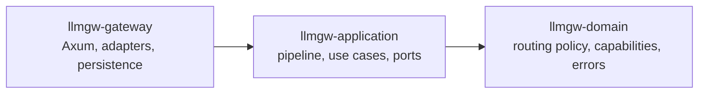
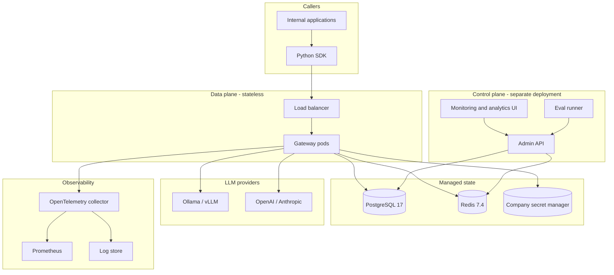
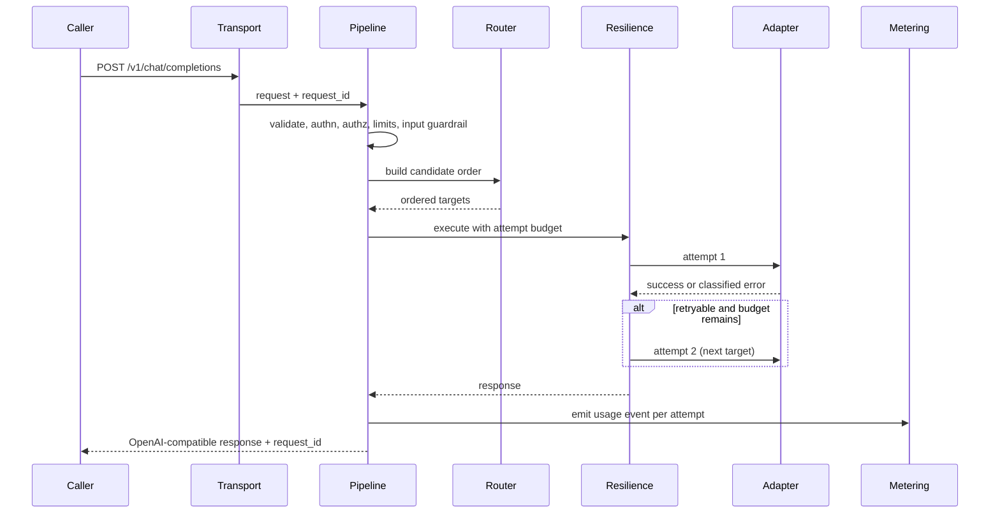
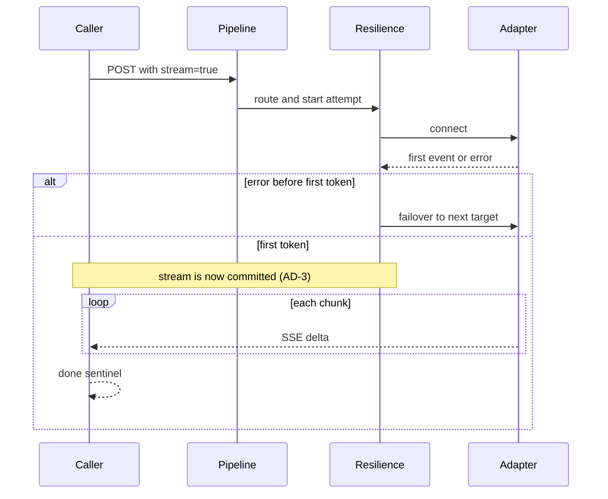
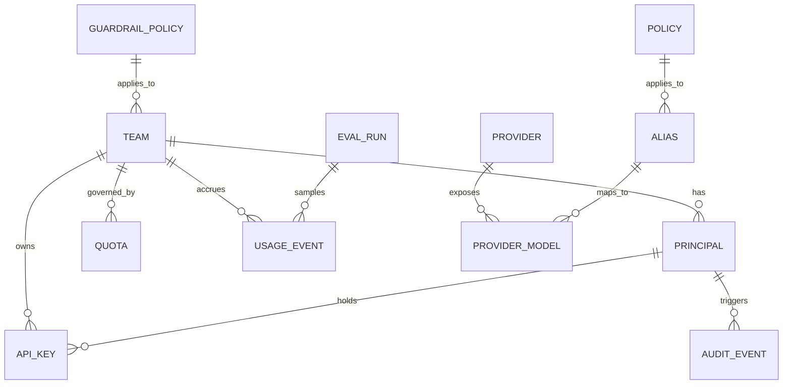

# Architecture Document — Internal LLM Gateway

| Field | Value |
| --- | --- |
| Status | Draft |
| Version | 0.1 |
| Date | 2026-11-07 |
| Owner | Winston (System Architect) |
| Inputs | `llmgw/PRD.md` (v0.2) |
| Build substrate | `llmgw/ARCHITECTURE-SPINE.md` |
| Audience | Build team, platform/SRE, security reviewers |

This document explains the architecture and the trade-offs behind it. The terse, machine-checkable invariants live in `ARCHITECTURE-SPINE.md`; this is the human-facing companion.

---

## 1. Context and Goals

The gateway is a company-owned front door for LLM traffic. Internal applications call one OpenAI-compatible API; the gateway authenticates them, enforces policy, selects a provider, streams tokens back, and records what happened. It starts as a provider router and hardens into a platform across four phases defined in the PRD.

Architectural goals, in priority order:

1. **Governance without friction.** Auth, quotas, validation, and audit must be mandatory and invisible to well-behaved callers.
2. **Reliability at the provider boundary.** A slow or failed provider must not become a product incident.
3. **Truthful observability.** Every request must be attributable to a team, a model, a provider, and a cost.
4. **Low latency.** Proxy overhead under 5ms p99, excluding inference.
5. **A clean domain.** Routing and cost rules must be testable without HTTP, Redis, or a provider.

Non-goals: hosting models, public multi-tenant SaaS, a billing system, agent/prompt frameworks, and non-chat modalities in v1.

---

## 2. Architectural Drivers and Constraints

| Driver | Source | Architectural consequence |
| --- | --- | --- |
| OpenAI-compatible surface (REQ-ENG-01) | PRD | Canonical internal request/response model; adapters translate at the edge. |
| SSE streaming without buffering (REQ-ENG-02) | PRD | Streaming must be end-to-end; no stage may require the full response. |
| Failover before first token (REQ-ENG-03) | PRD | A single commit boundary shared by routing and resilience. |
| DDD separation (NFR maintainability) | PRD | Hexagonal layers with an enforced dependency direction. |
| Secrets never in config (REQ-SEC) | PRD | A secrets port; no secret in DB, env files, logs, or traces. |
| 99.9% v1 availability (NFR) | PRD | Stateless pods, shared ephemeral state, health-aware routing. |
| Cost attribution to team/model (REQ-COST) | PRD | Immutable usage events with a cost snapshot. |
| Internal deployment | PRD | Kubernetes, managed Postgres/Redis, company identity and secret manager. |

**Constraint that shapes everything:** streaming and retries are in tension. You cannot transparently fail over a response once the caller has seen tokens. We resolve that with an explicit, documented boundary rather than pretending otherwise.

---

## 3. Design Paradigm

**Hexagonal ports and adapters over a DDD core.** Three workspace crates:

- **Domain** has no dependencies. It decides *what order targets should be tried in* and *what a request is capable of*, given inputs. Pure functions, deterministic, unit-testable.
- **Application** orchestrates use cases and defines ports (provider, secret store, rate limiter, usage store, identity, telemetry). It owns the pipeline order.
- **Gateway** implements ports with Axum, reqwest, sqlx, redis, OIDC, and OTLP.

Why not a single monolithic crate? The domain boundary is the one thing most likely to erode under delivery pressure. Making it a crate with a one-way dependency turns "please keep routing out of the handler" from a code-review opinion into a compile error.

Why not microservices per pipeline stage? The pipeline is on the hot path; a network hop per stage would blow the latency budget and multiply operational surface. The monolith is modular internally, with the control plane split out because it has different scaling and credential needs.

---

## 4. System Overview

**Data plane** serves `/v1/chat/completions` and the streaming path. It reads configuration, appends usage and audit events, and holds no administrative credentials.

**Control plane** owns writes to teams, principals, API keys, aliases, providers, quotas, policies, guardrails, and budgets. It exposes a separate API for the web app and the eval runner.

**Shared state:** Postgres is the system of record; Redis is disposable and rebuildable. This split is deliberate: losing Redis degrades rate limiting and health routing briefly, but loses no business fact.

---

## 5. Component Responsibilities

| Component | Responsibility | Does not |
| --- | --- | --- |
| HTTP transport (Axum) | Routing, request id, body limits, SSE framing, graceful shutdown | Make policy decisions |
| Validation stage | OpenAI schema, size/token limits, model and parameter guard | Call providers |
| Identity stage | OIDC/JWT and API-key resolution, principal and team | Manage teams or keys |
| Authorization stage | Scope checks for team, alias, model, operation | Know provider details |
| Limits stage | Token-bucket rate limits and quotas in Redis | Persist durable usage |
| Guardrail stage | Input policy checks (allow/flag/redact/block) | Couple to a vendor |
| Router (domain) | Pure ordering of candidate targets from policy and health | Perform I/O |
| Resilience loop | Attempt budget, circuit state, retries, failover | Retry after stream commit |
| Provider adapters | Wire translation, capability descriptor, error mapping | Leak provider fields |
| Metering | Emit one immutable usage event per attempt | Rewrite history |
| Audit | Record security-relevant actions | Store prompt bodies by default |
| Control-plane API | Admin writes and read models | Serve inference traffic |
| Web app | Dashboards, health, cost, admin | Talk to providers or Redis directly |
| Python SDK | Typed requests, SSE parsing, mapped exceptions | Route, retry, or fail over |

---

## 6. Request Lifecycle

### 6.1 Non-streaming request

### 6.2 Streaming request

**The commit rule:** after the first forwarded token, no retry and no failover. A mid-stream failure emits one gateway error event and terminates the stream. This is the single most important behavioral rule in the system; it must be enforced in one place and tested explicitly.

### 6.3 Stage order (fixed)

Output guardrails are deferred for streaming; when implemented they must not buffer a committed stream. Input guardrails are Phase 3.

---

## 7. Routing and Failover Design

### 7.1 Routing is a pure function

The domain receives the request, principal, resolved policy, capability requirements, and a health snapshot, and returns an ordered list of candidate targets with reasons. Inputs it may consider:

- Alias intent (`auto`, `fast`, `cheap`, `smart`) and explicit model requests.
- Capability requirements: tools, JSON mode, vision, minimum context window.
- Cost ceiling and remaining team budget.
- Latency objective and current provider latency signals.
- Data residency / provider allow-list for the team.
- Provider health: down vs degraded (slow) vs healthy.
- Static weights and fallback order from policy.

Determinism matters: the same inputs must yield the same order, or debugging and eval comparisons are meaningless. Time and health are inputs, not hidden reads.

### 7.2 Error taxonomy drives behavior

| Upstream outcome | Fail over? | Notes |
| --- | --- | --- |
| 400/422 validation | No | Caller error; map through AD-11. |
| 401/403 provider auth | No (alert) | A gateway configuration problem, not a caller problem. |
| 429 with Retry-After | Yes, within attempt budget | Never sleep past the budget; prefer next target. |
| 5xx | Yes | The primary failover trigger. |
| Connect/read timeout before first token | Yes | Uses the attempt budget. |
| Mid-stream error after first token | No | Terminate with error event (AD-3). |
| All targets exhausted | No | Return 502/503 with gateway error code. |

### 7.3 Circuit breaker and health

Circuit state is per provider, shared in Redis: closed, open, half-open. Opening is driven by an error-rate and latency threshold over a rolling window. The health cache distinguishes **down** (failures, connect errors) from **slow** (elevated p95/TTFT), because a slow provider may still be usable for non-latency-sensitive requests. Health feeds the routing function as an input; it is not consulted mid-stream.

### 7.4 Attempt budget and double billing

Each request has a maximum attempt count and maximum elapsed time. Each attempt emits its own usage event, so a retried request shows two upstream attempts and any duplicate billing is visible rather than hidden. The client may supply an idempotency key; the gateway always generates a request id.

---

## 8. Data Architecture

### 8.1 Ownership and consistency

- **Postgres** owns control-plane entities, usage events, and audit events.
- **Redis** owns rate-limit counters, circuit state, and the health cache.
- **In-process snapshot** caches versioned configuration; refresh is bounded and observable.

There is no distributed transaction between Postgres and Redis. On restart, Redis state rebuilds from traffic and active probes; configuration reloads from Postgres. Usage events are written by a batched async writer and are immutable once written.

### 8.2 Core entities

Key invariants:

- Every usage event is keyed by request id plus attempt id.
- Cost is a snapshot computed from the price table version in force at event time.
- Aggregates are derived views, never edited facts.
- Audit events are append-only.

### 8.3 Body data

Prompts and completions are not persisted by default (AD-17). Telemetry and usage records carry metadata only. Optional body capture is a per-team, redacted, bounded-retention feature requiring an explicit policy.

---

## 9. Security Architecture

### 9.1 Authentication and authorization

- Callers authenticate with an OIDC JWT or a gateway-issued scoped API key.
- Every principal belongs to exactly one team.
- Scopes constrain allowed aliases, models, providers, and operations.
- RBAC roles: platform admin, team admin, developer, viewer, service.
- API keys are stored hashed; plaintext is shown once at creation.
- Provider credentials never leave the gateway and are never returned by any API.

### 9.2 Secrets

Secrets live in the company secret manager and are resolved at runtime through a secrets port with a short TTL cache. Provider keys are never written to Postgres, config maps, environment files, or logs. Redaction is covered by tests, not policy statements alone.

### 9.3 Control/data plane separation

The data plane holds no administrative credentials and cannot write configuration. The control plane exposes a separate API authenticated for humans and admin services. The web app talks only to the control-plane API.

---

## 10. Observability

**Traces.** One trace per request, with spans named for the fixed pipeline stages and upstream attempts. The request id is returned to callers and propagated to providers where supported.

**Metrics.** Prometheus, `llmgw_` namespace. Core series:

- `llmgw_requests_total` by team, alias, provider, status.
- `llmgw_request_duration_seconds` and `llmgw_ttft_seconds`.
- `llmgw_proxy_overhead_seconds` (stage time minus upstream time).
- `llmgw_fallback_total` and `llmgw_retry_total`.
- `llmgw_circuit_state` by provider.
- `llmgw_tokens_total` and `llmgw_cost_micros_total` by team/model.
- `llmgw_quota_rejections_total`.

**Logs.** Structured `tracing` logs with request id, team, alias, provider, outcome. No prompt/response bodies by default.

**Alerts.** SLO burn, circuit open, fallback spike, quota/budget breach, secret resolution failure, config refresh failure.

---

## 11. Reliability and Performance

- **Latency budgets per stage.** Validation, auth, limits, and routing are in-memory or single Redis round-trips. Guardrails and body work are the main risks to the 5ms target; they must be measured per stage and made optional for latency-sensitive teams.
- **Backpressure.** Bounded concurrency per provider and per team; reject early with 429 rather than queue unboundedly.
- **Timeouts.** Separate connect, first-token, and inter-chunk timeouts. Timeouts are budgeted, not fixed per attempt in isolation.
- **Graceful shutdown.** Stop accepting new requests, drain in-flight streams up to a deadline, then terminate.
- **HA.** Stateless pods, multiple replicas, PodDisruptionBudget, managed Postgres/Redis with failover. 99.9% is the v1 SLO; 99.99% requires health orchestration and multi-zone work that is explicitly deferred.

---

## 12. Deployment and Environments

- Kubernetes for data plane, control plane, and web app; same manifests across environments with value overlays.
- Managed Postgres and Redis; migrations run as a gated job, not on pod startup.
- Secrets via the secret manager (for example Vault with External Secrets Operator).
- OpenTelemetry collector as a DaemonSet or sidecar feeding Prometheus and the log store.
- Environment promotion: dev, staging, production; configuration is data, promoted through the control plane, not baked into images.

---

## 13. Failure Modes and Degradation

| Failure | Behavior | Recovery |
| --- | --- | --- |
| A provider is down | Circuit opens; routing avoids it; other targets serve. | Half-open probes restore it. |
| A provider is slow | Health marks it degraded; routing deprioritizes for latency-sensitive requests. | Passive signals clear it. |
| Redis unavailable | Rate limiting fails closed (configurable) or degrades to local limits; circuit state falls back to local. | Redis reconnects; state rebuilds. |
| Postgres unavailable | Data plane continues with cached config; usage events buffer with bounded retry. | Writer drains; overflow is logged and dropped with an alert. |
| Secret store unavailable | Cached secrets continue until TTL; new providers fail with a clear error. | Refresh resumes. |
| Config refresh fails | Continue on last known good snapshot; alert. | Next refresh succeeds. |
| Mid-stream provider failure | Stream terminates with error event; no retry. | Caller retries the request. |

The degradation policy for each dependency is explicit; none is allowed to silently become a hard failure.

---

## 14. Phase Mapping

| PRD phase | Architecture work | Exit signal |
| --- | --- | --- |
| Phase 0 — Router | Domain routing function, OpenAI surface, Ollama/vLLM/OpenAI adapters, streaming commit rule, validation, secrets port, OTel/Prometheus, SDK sync + stream. | One team streams through the gateway; failover before first token works. |
| Phase 1 — Production pilot | Identity + RBAC, attempts/circuit, health, config snapshot, aliases, error taxonomy, alerts, health dashboard, SDK exceptions/context manager. | 3–5 teams onboarded; RBAC enforced; on-call runbook. |
| Phase 2 — Cost and control | Rate limits/quotas, usage events and cost, capability-aware routing, circuit automation, cost dashboard, admin console, audit viewer. | Cost attributable; quotas enforced. |
| Phase 3 — Safety and quality | Input guardrails, budgets/alerts, eval harness and gates, output guardrails. | Guardrails configurable; eval gate for alias/model changes. |

---

## 15. Key Decisions and Trade-offs

| ID | Decision | Alternative considered | Why this way |
| --- | --- | --- | --- |
| AD-1 | Hexagonal DDD monolith | Layered monolith, microservices | Keeps routing pure and testable; avoids network hops on the hot path. |
| AD-2 | Fixed pipeline order | Per-route middleware stacks | Governance cannot be accidentally bypassed; order is auditable. |
| AD-3 | Failover only before first token | Mid-stream failover | Transparency is impossible without buffering or duplicated output. |
| AD-4 | Normalized adapter contract + capabilities | Pass-through per provider | Makes fallback safe and prevents provider leakage. |
| AD-5 | Pure routing function | Routing inside adapters | Deterministic, unit-testable, reproducible. |
| AD-6 | Postgres + Redis, no broker | Kafka + ClickHouse from day one | Boring technology; the pilot does not need streaming analytics. |
| AD-7 | Secret manager only | Encrypted secrets in DB | Removes a class of key sprawl and audit risk. |
| AD-8 | OIDC or scoped keys | Shared provider keys | Tenant isolation and attribution require a first-class principal. |
| AD-9 | Immutable usage events | Mutable counters | Reconciliation and historical cost truth. |
| AD-10 | Fixed telemetry contract | Ad-hoc metrics per module | Shared dashboards and alerts; predictable cardinality. |
| AD-11 | Gateway error taxonomy | Forward provider errors | Stable SDK/UI behavior and no secret leakage. |
| AD-12 | Split control plane | One service for everything | Different scaling, credentials, and blast radius. |
| AD-13 | Kubernetes + managed state | VMs with self-managed DB | Operational realism for an internal platform. |
| AD-14 | In-process guardrails | Sidecar guardrail service | Latency and simplicity; interface keeps the vendor swappable. |
| AD-15 | Attempt budget + idempotency | Unbounded retries | Prevents storms and double billing. |
| AD-16 | Thin SDK | SDK-side routing/failover | One source of truth for behavior. |
| AD-17 | No body persistence by default | Log everything | Data minimization; opt-in redacted capture. |

---

## 16. Risks

| Risk | Impact | Mitigation |
| --- | --- | --- |
| Streaming edge cases (commit rule, disconnect, backpressure) | Corrupt output or stuck connections | Explicit state machine, contract tests, load tests, chaos on provider failure. |
| Guardrails blow the latency budget | Misses the 5ms target | Per-stage budgets, async/optional guardrails, measure before enabling. |
| Redis is a single point of contention | Limit/circuit degradation | Local fallback, bounded operations, managed HA. |
| Config snapshot staleness | Policy changes delayed | Versioned snapshots, short refresh, observable config version. |
| Cost price table drift | Wrong reports | Versioned price table and cost snapshots; reconciliation job. |
| Scope sprawl across phases | Nothing ships | Phase gates from the PRD; Phase 0 kept deliberately small. |
| Competing with mature gateways | Low differentiation | Validate the internal-controls angle; adopt for commodity parts. |

---

## 17. Open Questions

1. Which OIDC provider, and which claim carries team and role?
2. Which secret manager, and what rotation cadence?
3. Which Kubernetes cluster(s), and who owns HA and capacity?
4. Are quotas and budgets hard-blocking or alert-only for the pilot?
5. What is the exact retry budget (attempts and elapsed time) per team?
6. Which provider wins when an alias conflicts across local and cloud targets?
7. Are guardrails inline for all teams or opt-in by policy?
8. Who owns golden datasets and eval thresholds?
9. What are the audit and metrics retention requirements?
10. Do any teams need non-chat modalities in v1?

---

## Appendix A — Error Codes

| Code | HTTP | Meaning |
| --- | --- | --- |
| `invalid_request` | 400 | Schema, parameter, or model validation failed. |
| `unauthorized` | 401 | Missing or invalid credentials. |
| `forbidden` | 403 | Principal lacks scope for team, alias, or model. |
| `rate_limited` | 429 | Gateway or team limit exceeded; Retry-After set. |
| `quota_exceeded` | 429 | Hard quota or budget reached. |
| `upstream_timeout` | 504 | Provider did not respond within budget. |
| `upstream_error` | 502 | Provider failed after all attempts. |
| `unavailable` | 503 | No healthy target or gateway dependency down. |
| `guardrail_blocked` | 400 | Request blocked by an input policy. |

## Appendix B — Metric and Span Names

Span names match the pipeline stages: `transport`, `validate`, `authn`, `authz`, `limits`, `guardrail.input`, `route`, `attempt`, `upstream`, `guardrail.output`, `meter`, `audit`.

Metric namespace is `llmgw_`. Label cardinality is bounded: team, alias, provider, status, circuit state. Request ids and prompts are never metric labels.
